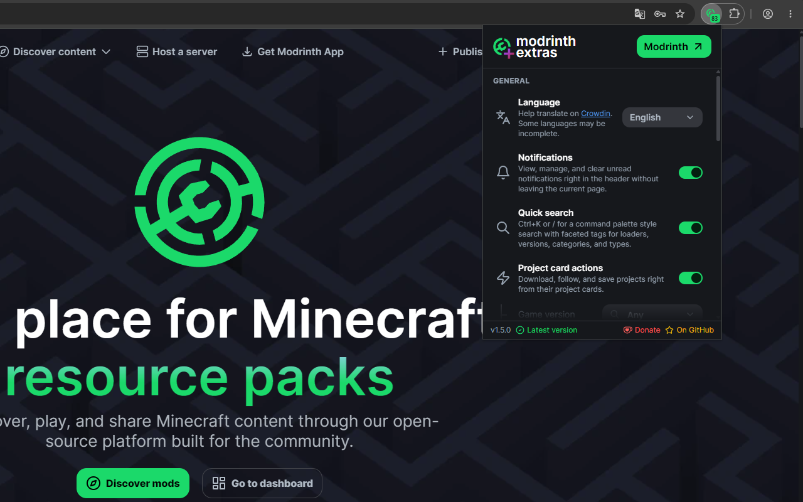
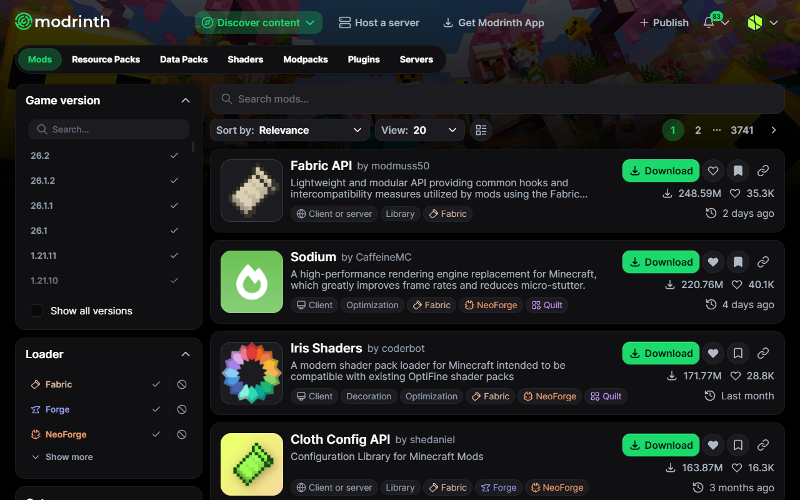
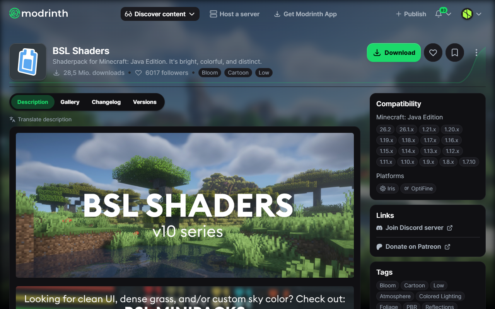
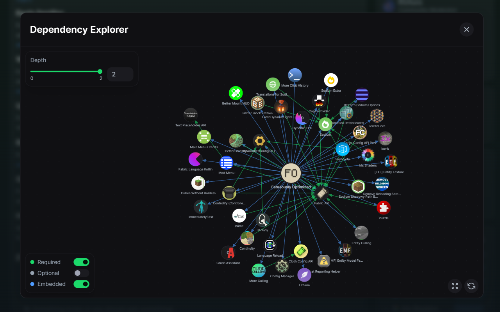
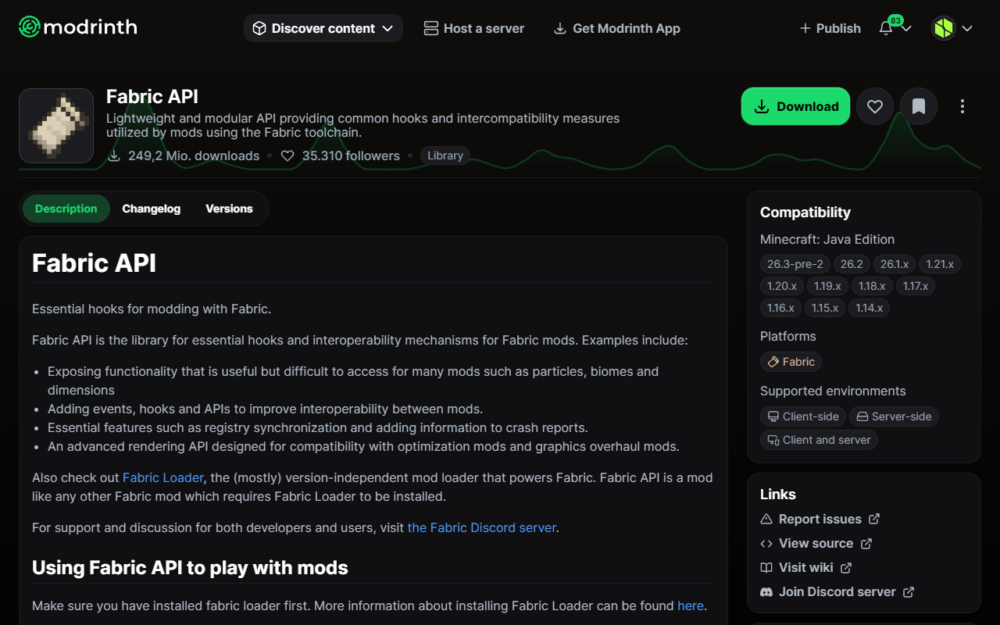
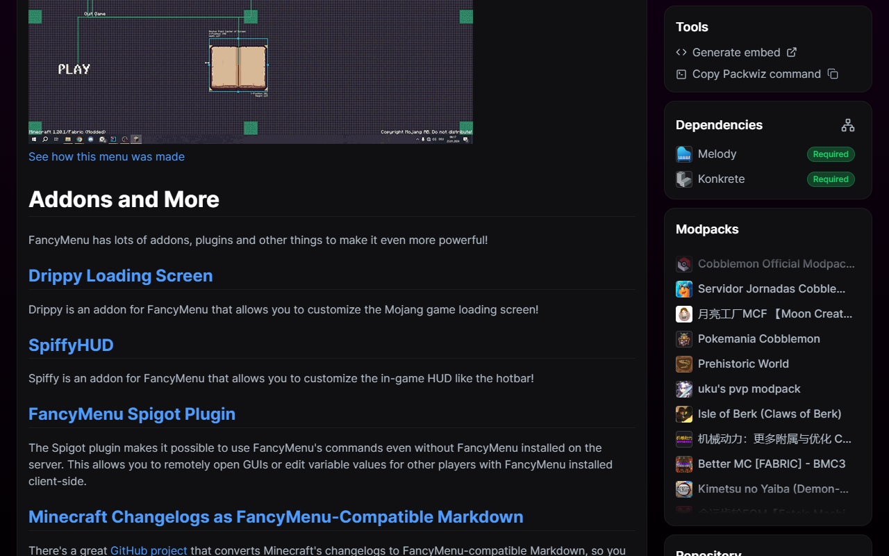

# 

A browser extension that enhances Modrinth on the website and beyond.


[](https://crowdin.com/project/modrinth-extras)


[](https://ko-fi.com/creeperkatze)

> [!NOTE]
> The extension is not associated with or endorsed by Modrinth.

## 🚀 Installation

Install from your browser's extension store:

- **[Chrome Web Store](https://chromewebstore.google.com/detail/modrinth-extras/ajmkilipadfpaefpcjfgnkejalmhdlcj)** 
- **[Firefox Add-Ons](https://addons.mozilla.org/firefox/addon/modrinth-extras/)** 
- **[Edge Add-Ons](https://microsoftedge.microsoft.com/addons/detail/modrinth-extras/jkfgnimibfpoohbmaibjdjdmfnjmbjcj)** 

Prefer to build from source? See [🔒 Building from source](#-building-from-source) below.

## ✨ Features

<table>
<tr>
<td width="50%"></td>
<td width="50%"><h3>Every feature, one click away</h3>Every feature can be individually toggled from the extension popup, so you can build the exact Modrinth experience you want.</td>
</tr>
<tr>
<td width="50%"><h3>Act without leaving the list</h3>Download, follow, save, and copy links for projects directly from their cards, no need to open each page.</td>
<td width="50%"></td>
</tr>
<tr>
<td width="50%"></td>
<td width="50%"><h3>A page that matches the project</h3>Display a project's featured gallery image as a full banner background, so shaders and resource packs look the part.</td>
</tr>
<tr>
<td width="50%"><h3>Notifications, right in the header</h3>View, manage, and clear unread notifications without leaving the page you're on, with optional browser notifications and an unread badge on the extension icon.</td>
<td width="50%"></td>
</tr>
<tr>
<td width="50%"></td>
<td width="50%"><h3>Explore the full dependency tree</h3>An interactive graph lets you dig through a project's required, optional, and embedded dependencies, as deep as you want to go.</td>
</tr>
<tr>
<td width="50%"><h3>Find anything in seconds</h3>Press Ctrl+K or / to open a command palette style search, with faceted tags for loaders, versions, categories, and types built right into your query.</td>
<td width="50%"></td>
</tr>
<tr>
<td width="50%"></td>
<td width="50%"><h3>See how active a project really is</h3>A release activity sparkline on every project page shows update frequency at a glance, before you even scroll down.</td>
</tr>
<tr>
<td width="50%"><h3>The full picture, right in the sidebar</h3>Repository stars, issues, and pull requests. Discord member counts. Every modpack a mod is featured in. All shown right in the sidebar.</td>
<td width="50%"></td>
</tr>
</table>

## 🔒 Building from source

If you don't want to trust the store release, you can build the extension yourself directly from the source code and verify it matches what's in the release.

**Prerequisites:** [Node.js](https://nodejs.org) and [pnpm](https://pnpm.io)

```bash
# Clone and check out the version you want to verify (e.g. v1.3.3)
git clone --recurse-submodules https://github.com/creeperkatze/modrinth-extras.git
cd modrinth-extras
git checkout v1.3.3

pnpm install

# Chrome / Edge
pnpm zip

# Firefox
pnpm zip:firefox
```

The resulting zips in `.output/` are identical to those attached to the [GitHub release](https://github.com/creeperkatze/modrinth-extras/releases) for that tag.

To install the extension manually:

- **Chrome / Edge:** go to `chrome://extensions/`, enable **Developer mode**, then drag and drop the zip onto the page.
- **Firefox:** go to `about:debugging#/runtime/this-firefox`, click **Load Temporary Add-on**, and select the zip. Note that Firefox removes the extension on browser restart since it is loaded as a temporary add-on.

## 👨‍💻 Development

### Setup

> [!IMPORTANT]
> The `--recurse-submodules` flag is required as the project imports packages from the [modrinth](https://github.com/modrinth/code) monorepo as a git submodule.

```bash
git clone --recurse-submodules https://github.com/creeperkatze/modrinth-extras.git
cd modrinth-extras

pnpm install
```

### Chrome

```bash
pnpm build
```

Then go to `chrome://extensions/`, enable **Developer mode**, click **Load unpacked**, and select the `.output/chrome-mv3` folder. After rebuilding, just click on the reload icon.

### Firefox

```bash
pnpm zip:firefox
```

Then go to `about:debugging#/runtime/this-firefox`, click **Load Temporary Add-on**, and select the zip from the `.output/` folder. After rebuilding, repeat this process.

> [!NOTE]
> `pnpm dev` can also be used during development to automatically create a temporary browser with the extension pre-loaded. Keep in mind that this browser profile is isolated, requiring you to log in each time. This method also causes issues with Modrinth's dependencies.

## 🌐 Translating

Translations are managed on [Crowdin](https://crowdin.com/project/modrinth-extras). You can contribute without any technical knowledge, just pick your language and start translating.

New translations are automatically pulled every Monday.

### Translators ❤️

| Language               | Translators                                                                                                                                                                         |
| ---------------------- | ----------------------------------------------------------------------------------------------------------------------------------------------------------------------------------- |
| Italian                | [EmanuelPlaysDev](https://github.com/EmanuelPlays)                                                                                                                                  |
| French                 | [maDU59_](https://github.com/maDU59), [Sertra](https://crowdin.com/profile/sertrafurr)                                                                                              |
| Chinese Simplified     | [xinyihl](https://crowdin.com/profile/xinyihl), [AlexYang](https://crowdin.com/profile/A012pyshjs210)                                                                               |
| Korean                 | [젠고](https://crowdin.com/profile/minejango2)                                                                                                                                      |
| Vietnamese             | [Lê](https://crowdin.com/profile/suri-cutie)                                                                                                                                        |
| Japanese               | [Finity 2010](https://crowdin.com/profile/finity2010)                                                                                                                               |
| Russian                | [vanapro1](https://crowdin.com/profile/vanapro1), [IceBan](https://crowdin.com/profile/iceban)                                                                                      |
| Ukrainian              | [Tenwoc](https://crowdin.com/profile/tenwoc), [CreativeTragern](https://crowdin.com/profile/creativetragern)                                                                        |
| Turkish                | [penfflewithadot](https://crowdin.com/profile/penfflewithadot), [ErenTr4210](https://crowdin.com/profile/erentr4210), [Serkan Aynacı](https://crowdin.com/profile/serkanaynaci2007) |
| Spanish, Latin America | [Dante Li Tao](https://crowdin.com/profile/heroxp)                                                                                                                                  |
| Arabic                 | [Hamad Alsayed](https://crowdin.com/profile/hamad_sayed)                                                                                                                            |
| Spanish                | [eh eh](https://crowdin.com/profile/ehuh)                                                                                                                                           |

## 🤝 Contributing

Contributions are always welcome!

Please ensure you run `pnpm lint:fix` and `pnpm fmt` before opening a pull request.

## 📜 License

AGPL-3.0
